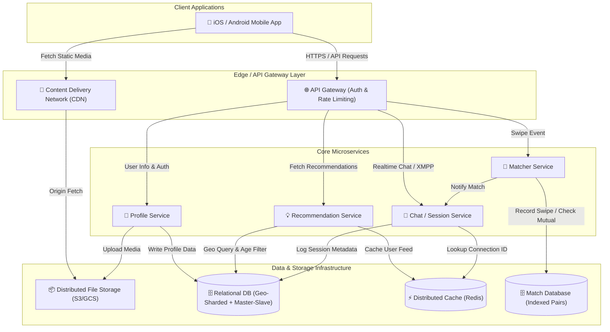

# High Level System Design: Tinder Architecture

> **Architectural Breakdown**: Design of a large-scale, location-based dating application supporting profile management, spatial recommendations, real-time matching, and peer-to-peer messaging.  
> **Original Reference**: Rajneesh Verma, Avash Mitra, and Gaurav Sen (*InterviewReady*).

---

## 📋 Table of Contents
1. [System Requirements & Scope](#1-system-requirements--scope)
2. [Capacity Estimations](#2-capacity-estimations)
3. [High-Level Architecture](#3-high-level-architecture)
4. [Component Deep-Dive & Trade-off Analysis](#4-component-deep-dive--trade-off-analysis)
   - [Requirement 1: Profile Creation & Media Storage](#requirement-1-profile-creation--media-storage)
   - [Requirement 2: One-to-One Chat Messaging](#requirement-2-one-to-one-chat-messaging)
   - [Requirement 3: Matcher Service](#requirement-3-matcher-service)
   - [Requirement 4: Recommendation Engine](#requirement-4-recommendation-engine)
5. [Database Schema Design](#5-database-schema-design)
6. [API Interface Specifications](#6-api-interface-specifications)
7. [System Trade-Off Matrix](#7-system-trade-off-matrix)
8. [LinkedIn Post & Diagram Templates](#8-linkedin-post--diagram-templates)

---

## 1. System Requirements & Scope

### 🎯 Functional Requirements (Prioritized)
1. **Profile Storage & Auth**: System must store user profiles (Name, Age, Gender, Location, Bio) and up to 5 profile images. Issue auth tokens via API Gateway.
2. **Location-Based Recommendations**: Recommend candidate profiles to users based on geographical proximity, age bounds, gender preferences, and historical right/left swipe choices.
3. **Match Engine**: Persist right-swipes and identify reciprocal matches immediately.
4. **Direct 1-on-1 Messaging**: Allow low-latency, real-time messaging between users **if and only if** a mutual match exists.

### 🚫 Out of Scope
- Profile moderation, automated content flags, or image nsfw filtering.
- Payments, tier subscriptions (Tinder Plus/Gold/Platinum), or boosted profiles.
- Rate limiting swipe counts per un-subscribed tier.

---

## 2. Capacity Estimations

| Metric | Estimated Value | Notes |
| :--- | :--- | :--- |
| **Active Users (DAU)** | 10,000,000 (10M) | Daily active footprint |
| **Photos per User** | 5 high-res photos | Average ~2 MB each |
| **Total Media Storage** | `10M × 5 × 2MB = 100 TB` | Served via Distributed Object Store + CDN |
| **Daily Matches** | 0.1% of active users (~1,000,000 daily match events) | 1,000 / sec peak match writes |
| **Chat Connections** | ~2,000,000 concurrent peak websocket/XMPP connections | Stateful session routing |

---

## 3. High-Level Architecture



---

## 4. Component Deep-Dive & Trade-off Analysis

### Requirement 1: Profile Creation & Media Storage

#### Description
Users sign up, generate authentication tokens, and upload profile attributes (Name, Age, Gender, Bio, Geo-coordinates) alongside up to 5 profile images.

#### Architectural Components
- **API Gateway**: Validates OAuth2/JWT bearer tokens, terminates TLS, load balances across downstream profile services.
- **Relational Database (User DB)**: Stores normalized user attributes and location references.
- **Distributed File System (DFS)**: Amazon S3 / Google Cloud Storage for media assets.
- **CDN (Content Delivery Network)**: Cloudflare / CloudFront caches static media at edge nodes near the user for millisecond image loading times.

#### ⚖️ Key Trade-off: Storing Images as Files (DFS) vs. Database BLOBs

| Feature / Criteria | Database BLOB Storage | Distributed File System + CDN (Chosen) |
| :--- | :--- | :--- |
| **Mutability** | High overhead for byte updates; unnecessary as photo updates replace the file entirely. | Files are static; replacing images requires writing a new file object. |
| **Transaction Guarantee** | ACID guarantees exist, but image uploads do not require atomic DB transactions. | Eventual consistency; decoupled from DB transaction bottlenecks. |
| **Indexing** | Searching image binary content is ineffective. | Indexed by simple URL strings in the database. |
| **Access Control & Speed** | DB bloat; slower backup & restore cycles. | **Significantly cheaper, scalable**, and **optimized for edge caching via CDN**. |

---

### Requirement 2: One-to-One Chat Messaging

#### Description
Allows real-time communication **only** between mutually matched users. Requires low-latency bidirectional message delivery and connection state management.

#### Architectural Components
- **Session Service**: Maintains user-to-connection mapping.
- **Redis Connection Cache**: Stores high-speed key-value mapping of `UserID -> ConnectionID` for instant routing.
- **XMPP / WebSocket Cluster**: Peer-to-peer enabled stateful socket connections for bidirectional communication.

#### ⚖️ Key Trade-off: HTTP Polling vs. XMPP (Extensible Messaging and Presence Protocol)

```
HTTP Polling (Inefficient):
Client  --- Poll Request (Any new msgs?) ---> Server
Client  <--- 200 OK (No new msgs) ----------- Server

XMPP / WebSockets (Efficient - Chosen):
Client 1 === Persistent Bidirectional Socket === Server === Socket === Client 2
```

- **HTTP Short/Long Polling**: High overhead, battery drain on mobile devices, and server load from redundant polling requests.
- **XMPP / WebSockets**: Establishes lightweight persistent peer-to-peer TCP streams. The server pushes messages instantaneously without repetitive polling requests.

---

### Requirement 3: Matcher Service

#### Description
Tracks swipe interactions (left/right) and evaluates whether a reciprocal right-swipe exists between two users.

#### Architectural Components
- **Matcher Microservice**: Evaluates incoming swipe events.
- **Relational Match DB**: Indexed database table storing `(user_id_1, user_id_2, status, created_at)`. Unique compound indexes ensure \(O(1)\) lookup speeds.

#### ⚖️ Key Trade-off: Client-Side vs. Server-Side Match Storage

| Criteria | Client-Side Storage | Server-Side Storage (Chosen) |
| :--- | :--- | :--- |
| **Data Durability** | If app is uninstalled or cache cleared, all match history is lost. | **Source of Truth** preserved across device switches or reinstallations. |
| **Security & Integrity** | High risk of tampering, spoofing matches, or local reverse engineering. | **Secure and non-tamperable**; business logic enforced at API boundary. |
| **Storage Overhead** | Minimal server footprint, but negligible benefit given pair storage is light (~64 bytes per match). | Scales easily with relational sharding & indexing. |

---

### Requirement 4: Recommendation Engine

#### Description
Generates a ranked feed of profiles tailored to user location (geographical proximity), age ranges, gender preferences, and prior swipe history (excluding already-swiped users).

#### Architectural Components
- **Recommendation Microservice**: Fetches candidate pools and ranks them.
- **Geographically Sharded Relational DB**: Databases partitioned horizontally by geohash / location regions.
- **Master-Slave Replication**: Read-heavy workload (~95% reads) routes queries to read slaves, ensuring high throughput and resilience if a primary DB fails.

---

## 5. Database Schema Design

### `users` Table
```sql
CREATE TABLE users (
    user_id VARCHAR(36) PRIMARY KEY,
    name VARCHAR(100) NOT NULL,
    age INT NOT NULL,
    gender VARCHAR(20) NOT NULL,
    target_gender VARCHAR(20) NOT NULL,
    latitude DECIMAL(9,6) NOT NULL,
    longitude DECIMAL(9,6) NOT NULL,
    bio TEXT,
    created_at TIMESTAMP DEFAULT CURRENT_TIMESTAMP
);
CREATE INDEX idx_user_location ON users (latitude, longitude);
```

### `matches` Table
```sql
CREATE TABLE matches (
    match_id VARCHAR(36) PRIMARY KEY,
    user_id_1 VARCHAR(36) NOT NULL,
    user_id_2 VARCHAR(36) NOT NULL,
    is_matched BOOLEAN DEFAULT FALSE,
    created_at TIMESTAMP DEFAULT CURRENT_TIMESTAMP,
    CONSTRAINT unique_user_pair UNIQUE (user_id_1, user_id_2)
);
CREATE INDEX idx_user_matches ON matches (user_id_1, is_matched);
```

### `user_sessions` Table
```sql
CREATE TABLE user_sessions (
    connection_id VARCHAR(64) PRIMARY KEY,
    user_id VARCHAR(36) NOT NULL,
    server_node_ip VARCHAR(45) NOT NULL,
    connected_at TIMESTAMP DEFAULT CURRENT_TIMESTAMP
);
```

---

## 6. API Interface Specifications

### 👤 Profile Service
- **`POST /api/v1/user/signup`**: Creates new profile account.
- **`GET /api/v1/user/login`**: Authenticates user and returns JWT access token.
- **`GET /api/v1/user/:userID`**: Retrieves public profile data.
- **`PUT /api/v1/user/:userID`**: Updates bio, preferences, or location coordinates.
- **`DELETE /api/v1/user/:userID`**: Permanently removes user account and assets.

### 💖 Matcher Service
- **`POST /api/v1/swipe`**: Records swipe action (`LIKE` or `PASS`).
- **`GET /api/v1/match`**: Returns active matches for the authenticated user.
- **`DELETE /api/v1/match/:userID`**: Unmatches a specific profile.

### 💬 Session Service
- **`POST /api/v1/session/connection/:userID1/:userID2`**: Establishes connection record for matched user pair.
- **`GET /api/v1/session/users/:connectionID`**: Fetches user pairs associated with an active socket stream.
- **`DELETE /api/v1/session/connection/:connectionID`**: Terminates connection session.

### 💡 Recommendation Service
- **`GET /api/v1/recommendation`**: Returns localized profile recommendations feed.

---

## 7. System Trade-Off Matrix

```
+--------------------------+-----------------------+------------------------+--------------------------+
| Subsystem                | Option A              | Option B (Chosen)      | Key Architecture Reason  |
+--------------------------+-----------------------+------------------------+--------------------------+
| Image Storage            | Relational DB BLOB    | Distributed DFS + CDN  | Lower cost, CDN caching, |
|                          |                       |                        | fast global loading      |
+--------------------------+-----------------------+------------------------+--------------------------+
| Chat Messaging           | HTTP Polling          | XMPP / WebSockets      | Bidirectional streams,   |
|                          |                       |                        | low mobile overhead      |
+--------------------------+-----------------------+------------------------+--------------------------+
| Match State Storage      | Client Local Storage  | Server-Side DB         | Source of truth, data    |
|                          |                       |                        | integrity & security     |
+--------------------------+-----------------------+------------------------+--------------------------+
| Database Architecture    | Centralized Monolith  | Location-based Shards  | High query throughput,   |
|                          |                       | + Master-Slave         | failover resilience      |
+--------------------------+-----------------------+------------------------+--------------------------+
```

---

## 8. LinkedIn Post & Diagram Templates

This repository includes production-ready assets for publishing Tinder's System Design on LinkedIn:

- **LinkedIn Post Copy**: [`LINKEDIN_POST.md`](./LINKEDIN_POST.md) — Pre-formatted post matching Discord search architecture layout.
- **SVG Vector Diagram**: [`tinder-architecture.svg`](./tinder-architecture.svg) — Dark-mode hand-drawn architecture diagram.
- **Excalidraw Scene JSON**: [`tinder-excalidraw.json`](./tinder-excalidraw.json) — Editable template for [Excalidraw.com](https://excalidraw.com).
- **Eraser.io Prompts & Syntax**: [`ERASER_DIAGRAM_PROMPT.md`](./ERASER_DIAGRAM_PROMPT.md) — Natural language AI prompts and Eraser markup code.

---

*Authored for GitHub documentation & System Design Reference.*
